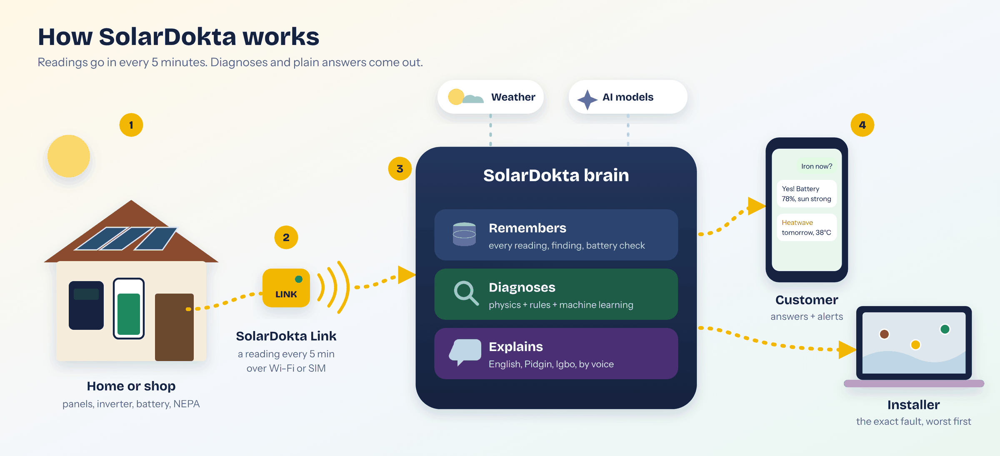
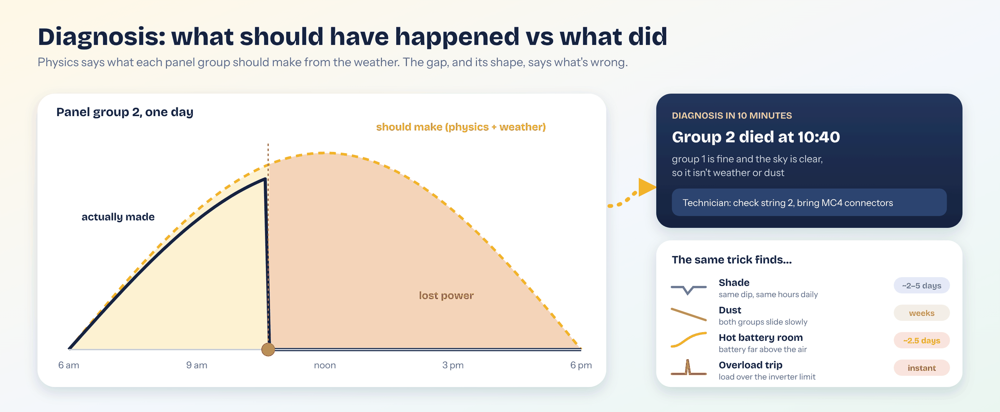
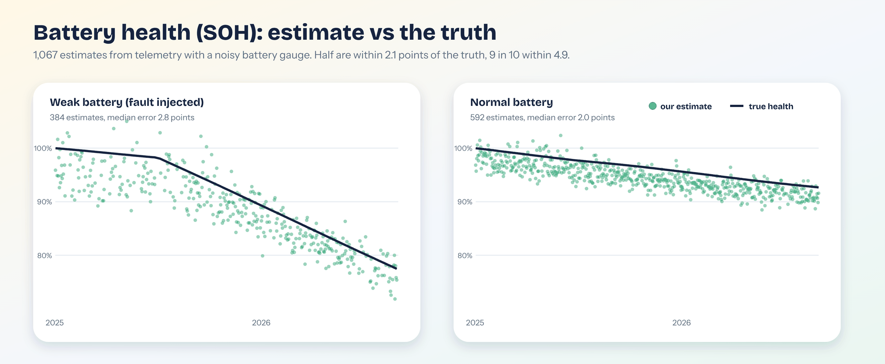
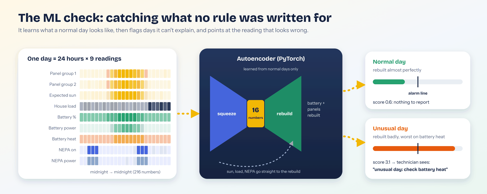
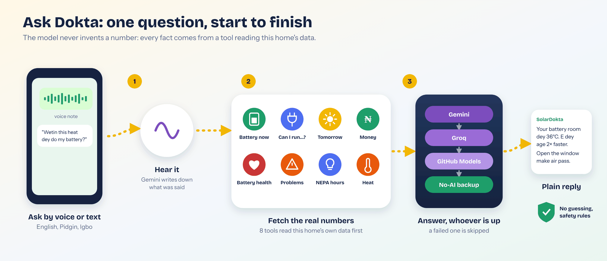
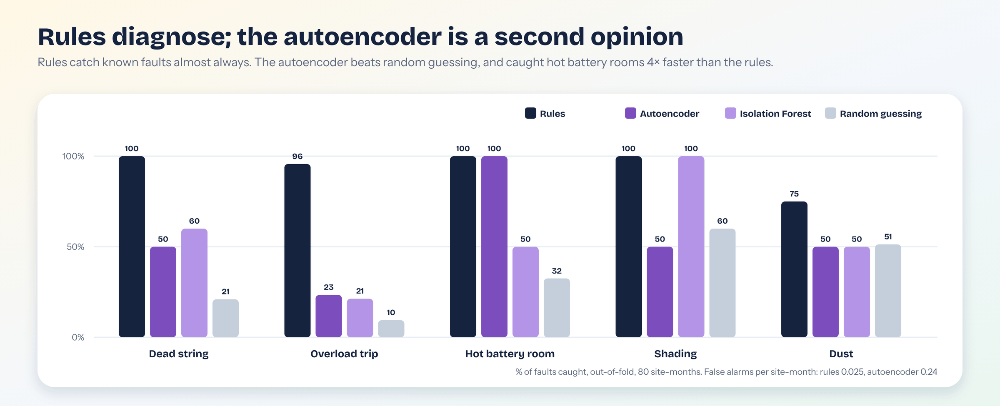

# SolarDokta

**Your solar system, finally talking to you.**

SolarDokta watches a home's or small business's solar system every 5 minutes. It tells the owner what is happening in plain English, Pidgin or Igbo, warns before something breaks, and gives the installer the exact fault before the customer has to call. It is built for Lagos and Port Harcourt, during a season of collapsing grid supply and a super El Niño that is quietly ageing batteries.

<!-- Screenshot of the landing page: add after deployment -->

| Try it (no account needed) | |
|---|---|
| Customer's view | `https://<your-app>.vercel.app/demo/customer` |
| Technician's view | `https://<your-app>.vercel.app/demo/technician` |

The demo is a simulated home in Ikeja that updates live every 5 minutes. You can look at everything, but nothing can be changed, and Ask Dokta allows 5 questions an hour per visitor.

---

## Contents

1. [The problem](#1-the-problem)
2. [Who it is for](#2-who-it-is-for)
3. [Diagnosis: from problem to design](#3-diagnosis-from-problem-to-design)
4. [What it does](#4-what-it-does)
5. [How it works](#5-how-it-works)
6. [AI engineering](#6-ai-engineering)
7. [Data and evaluation](#7-data-and-evaluation)
8. [Impact and business model](#8-impact-and-business-model)
9. [Limitations and responsible AI](#9-limitations-and-responsible-ai)

---

## 1. The problem

**Nigeria runs on generators and is moving to solar as fast as it can.**

- Nigerians spend about **$12 billion a year** on generators and fuel ([TheCable, citing Bloomberg](https://www.thecable.ng/?p=385186)).
- **70.7% of Nigerian firms** own or share a generator, and power cuts cost them about **3% of annual sales** ([AfDB *African Economic Outlook 2026*, via Nairametrics](https://nairametrics.com/2026/05/31/power-outages-cost-nigerian-firms-3-of-annual-sales-afdb-report/)).
- In 2025 Nigerians imported about **₦435 billion** of solar panels ([NBS trade statistics, via Legit.ng](https://www.legit.ng/business-economy/energy/1703439-electricity-woes-push-nigerians-spend-n435bn-29-million-solar-panels-in-2025)), making Nigeria **Africa's second-largest solar importer** ([Nairametrics](https://nairametrics.com/2025/08/26/nigeria-emerges-as-africas-second-largest-solar-importer-amid-60-surge-across-continent/)).

**But solar in Nigeria fails quietly.** A home system costs millions of naira, and almost none of them are monitored. When one group of panels (a "string") dies, the lights still come on, just for fewer hours, so the owner keeps buying fuel for months without knowing why. Dust, shade from a new building, a battery cooking in a sealed store room, an inverter tripping every evening: the owner only sees "light no dey". The installer finds out when an angry customer calls, drives across Lagos, and often can't prove what went wrong.

**Two things make it worse right now.**
- **The grid has collapsed.** Since mid-October 2026 many areas get only a few hours of NEPA a day, so batteries do far more work than they were sized for.
- **A super El Niño.** The WMO and NiMet expect a strong El Niño to keep Nigeria hotter than usual until early 2027. Batteries wear roughly **twice as fast for every 10°C above 25°C**, and the battery is the most expensive part of the system.

---

## 2. Who it is for

| Person | Today | With SolarDokta |
|---|---|---|
| **Ada, homeowner in Ikeja.** Paid ₦3–5 million for 5 kWp and 10 kWh. | Doesn't know if the system is healthy, guesses whether she can iron tonight, runs the generator "just in case". | Plain answers in her language ("Yes, iron before 2 pm"), warnings before the battery runs out, and proof of her battery's health. |
| **Tunde, an installer with 40–200 customers.** | Learns about faults from angry calls. Can't tell a dead string from a dirty panel over the phone. Loses warranty disputes without data. | Every site on one screen, worst first, with the exact fault and what to bring. Measured battery health for warranty claims. |
| **A shop, a clinic, a cold room.** | A blackout means lost sales or spoiled medicine. | Early warning when tonight's battery won't last, so heavy loads move to daylight. |

---

## 3. Diagnosis: from problem to design

Every design choice below starts from something the problem demands.

| The problem demands… | So we built… | Why, and what we deliberately did *not* do |
|---|---|---|
| **Knowing *why* output dropped**, not just that it dropped. Low output can mean cloud, dust, shade, a dead string or a weak panel. | **Physics first.** For every 5 minutes we compute what each string *should* produce from the weather at that roof (pvlib). Rules compare actual with expected. | A black-box classifier can say "something is off" but not "string 2 is dead, bring a fuse". Installers need the cause, and customers need a reason they can trust. |
| **Learning faults with no labelled data.** Nobody in Nigeria has a dataset of labelled solar faults. | **A physics simulator** that injects faults on a known schedule, so every fault is labelled and we can measure recall and delay honestly. | We did not train a supervised fault classifier. With almost no labelled examples it would learn the simulator, not the world. |
| **Catching problems nobody wrote a rule for.** | **An autoencoder trained on normal days only.** It needs no fault labels: anything it can't rebuild is unusual. | It raises about 3 false alarms per site a year, so it goes **to technicians only**, as "have a look", never to customers. |
| **Answers grounded in *this* home's numbers**, which change every 5 minutes. | **A tool-calling agent.** Each tool reads the live site data (battery, forecast, faults, prices). | **No RAG:** the facts are live numbers in a database, not documents to search. Retrieving text chunks would give stale or approximate figures. **No fine-tuning:** the knowledge changes every 5 minutes, and the style is easy to set in the prompt. |
| **Never inventing a number** about someone's money or battery. | Rules say every figure must come from a tool; if there's no data, say so. | The model writes sentences, the data supplies the numbers. |
| **Working on Nigerian networks and free budgets.** AI services time out, hit quotas or are blocked by some networks. | **A chain of AI providers** (Gemini → Groq → GitHub Models → more), plus a **no-AI backup** that writes the answer straight from the tool results. | Relying on one provider would make the product unusable on a bad day. |
| **Reaching people as they actually talk.** | **English, Pidgin and Igbo, voice notes, WhatsApp**, and receipts read from photos. | Many owners would rather send a voice note in Pidgin than type English into an app. |
| **Saying when the battery will need replacing**, with El Niño heat. | **Measured battery health (SOH)** from deep discharges, plus a **heat model** that projects life "as now" vs "kept cool". | A typical datasheet figure ignores how hot *this* battery room actually is. |

---

## 4. What it does

**For customers** (web, and WhatsApp next)
- **Home:** one plain sentence about right now, a live picture of the system, "Can I use…?" for any appliance, open problems explained, tonight and tomorrow, and an El Niño banner.
- **My usage:** any day or range, told as sentences ("97% of what you used came from your solar"), with NEPA hours, heat, naira saved and battery health.
- **Learn:** 16 solar words (SOC, SOH, string…) with pictures, how *yours* is doing, sliders and a quick quiz.
- **Tell us:** photos of token or fuel receipts set real prices, voice notes reach the technician, nameplate photos are checked against the records.
- **Ask Dokta:** typed or spoken, answered in English, Pidgin or Igbo.
- **Battery report:** a printable page from installation to replacement, with cycles, the projection with heat vs kept cool, and a resale grade.

**For installers and technicians**
- **Overview and map:** "3 of your 40 sites need a visit today", ranked by urgency with what to bring. Pins coloured by problems, heat risk or NEPA hours.
- **Problems inbox:** every finding, worst first; resolve or dismiss with a note.
- **What-if lab:** test any site against NEPA collapse, a heatwave, a sealed battery room, dust, a dead string or a new AC over the next 7 days.
- **Ask Dokta for the fleet:** "Which batteries are suffering most from the heat?"

<!-- Screenshots: customer home, my usage, ask dokta, technician overview, map, what-if: add after deployment -->

**What makes it different:** it explains *why* (physics, not just inverter numbers), it is built for Nigerian reality (NEPA, naira, Pidgin, Igbo, voice, heat), it works with any inverter brand through one small box, it turns battery health into evidence, and it keeps answering when the AI services don't.

---

## 5. How it works

1. **The home:** panels, inverter, battery and NEPA.
2. **The SolarDokta Link** (planned hardware, an ESP32-class box on the inverter's data port) sends a reading every 5 minutes over Wi-Fi or a SIM. In this build a **physics simulator** stands in for four sites (three in Lagos, one in Port Harcourt), driven by real weather.
3. **The brain:**
   - remembers every reading, finding and battery check (Supabase)
   - diagnoses with physics, rules and machine learning
   - explains with the AI agent
4. **People:** the customer gets plain answers and alerts; the installer gets the exact fault, worst first.

**What runs when** (Supabase Cron calls the API with a shared secret):

| Schedule | Job |
|---|---|
| every 5 minutes | Read each site, save telemetry, update hourly and daily totals |
| every hour | Run the rule detectors; open, update or close findings |
| every 3 hours | Save the 3-day weather forecast (tomorrow's plan, heatwave warnings) |
| nightly | Score yesterday with the ML anomaly model; delete raw readings older than 30 days |

**Stack**

| Layer | Technology |
|---|---|
| Web | Next.js 15, React 19, Tailwind CSS 4, Recharts, Leaflet (OpenStreetMap), on Vercel |
| API | Python, FastAPI, Pydantic, on Render |
| Data | Supabase: Postgres, Auth with Row Level Security, private Storage, Cron |
| Physics | pandas, NumPy, pvlib; weather from Open-Meteo and NASA POWER |
| Machine learning | PyTorch autoencoder served on Modal; scikit-learn Isolation Forest as fallback |
| Language AI | Gemini (chat, voice, reading receipts), Groq, GitHub Models, OpenRouter, Mistral |
| Messaging | Twilio WhatsApp |
| Quality | 138 automated tests (pytest), Ruff, ESLint, TypeScript |

---

## 6. AI engineering

SolarDokta has two kinds of AI that do different jobs: **diagnosis** (physics, rules and ML that find what is wrong) and **conversation** (an agent that explains it). The agent never diagnoses on its own; it reads what the diagnosis found.

### 6.1 Diagnosis: physics and rules

**Expected solar.** For every 5-minute step, a pvlib model works out what each string *should* make from sunlight and temperature at that roof, and the panels' size, tilt, direction and heat losses. The ratio of actual to expected is what turns "low output" into a cause:

| Signature | Diagnosis |
|---|---|
| One string near zero while the other works | **Dead string** |
| One string's ratio low for days, from the start | **Underrated panel** |
| A dip at the same hours every day | **Shading** |
| Both strings sliding down slowly together | **Dust** |
| Inverter fault code + load above rating | **Overload trip** |
| Battery much hotter than the outside air | **Hot battery room** |
| Battery health trending down faster than normal | **Battery fading** |
| Forecast high above threshold | **Heatwave tomorrow** |

Each becomes one finding (no duplicates) that closes itself when the problem clears.

### 6.2 Battery health and El Niño heat

- **SOH from real use.** Every night the battery drops by 30% or more, we compare the energy that came out with the charge used. That gives one health estimate. The fade rate is a **Theil–Sen** trend across many nights, so single bad readings don't mislead.
- **When the battery gauge is wrong.** The simulated BMS drifts and is slightly off in scale, like a real one. Even so, half the estimates are within **2.1 points** of the truth and 9 in 10 within **4.9 points**.
- **Heat model.** Ageing speed = 2^((T − 25) / 10), from the battery's measured temperature. The report projects health month by month "as now", with El Niño until February 2027, against "kept at 25°C", and states the months of life the heat costs.
- **Low confidence is honest.** When a battery has had few deep discharges (ph-001 had 79 in 20 months), the measured trend isn't trusted, and the report falls back to the chemistry model.

### 6.3 The ML anomaly check

Rules only catch what someone thought of. The autoencoder is a second opinion for everything else.

**Training data**
- Each **site-day** becomes 216 numbers: 24 hours × 9 channels (string 1, string 2, expected solar, load, battery %, battery power, battery heat, NEPA on, NEPA power). Everything is scaled by the site's own size, so one model serves small and large systems.
- **Clean days only:** days with no fault label. lagos-002 has a weak panel from day one, so it contributes no clean days.
- **Realistic noise:** the model sees a noisier copy of the weather than the simulator used (about 12% hourly and 5% daily error on sunlight, 1°C on temperature), plus the drifting battery gauge.

**Model** (PyTorch)
- Encoder 216 → 128 → **16**, ReLU, dropout 0.1.
- **Context goes around the bottleneck.** Expected solar, load and NEPA are fed straight to the decoder. The decoder only rebuilds the 120 **health** numbers (strings and battery). So a cloudy day or a NEPA blackout is not "unusual"; a string that underperforms *given* the sun is.
- Adam, learning rate 1e-3, weight decay 1e-5, 150 epochs, batch 64.
- **Alarm line:** the 99.5th percentile of rebuild error on 15% of clean days held back from training.
- **Hint:** the channel with the worst rebuild error is shown to the technician ("check battery heat").
- Served on **Modal** (serverless). An **Isolation Forest** (300 trees) on the same features is the fallback.

**How it was tested:** time-blocked 4-fold cross-validation with a 7-day gap between training and test blocks, so the model never sees the days around the ones it is scored on. A random-guessing baseline that raises the same number of alarms shows what "better than chance" means.

### 6.4 Conversation: Ask Dokta

1. **Question:** typed or a voice note. For voice, the browser records the clip and Gemini transcribes it, primed with the words Nigerians actually use (NEPA, pressing iron, pumping machine…). The audio is not stored.
2. **Language:** English, Pidgin or Igbo, from the app's switch or detected from the words.
3. **Fast path:** keywords pick the tools needed ("iron" → `can_i_run`, "tomorrow" → `tomorrow_plan`). Those tools run *before* the model is called, in parallel, so most answers need one model call.
4. **Model:** gets the system rules, this customer's system, the last 10 messages, the question and the live data. It may call more tools, up to 4 rounds.
5. **Checks:** echoed instruction tags are removed, a reply in the wrong language is retried once, and replies stay short enough for WhatsApp.

| Tool | Answers |
|---|---|
| `battery_now` | Battery %, charging or not, hours left, whether it reaches the morning sun |
| `can_i_run` | Whether an appliance can run now without tripping the inverter or emptying the battery before morning |
| `tomorrow_plan` | Forecast solar, best hours for heavy loads |
| `money_view` | Naira saved, NEPA spend, fuel avoided (from the customer's own receipts when available) |
| `battery_card` | Health, fade per year, cycles, years to 80% |
| `open_problems` | Findings in plain words, with what to do |
| `light_tracker` | NEPA hours per day vs what the tariff band promises |
| `heat_outlook` | Battery temperature, ageing speed, life lost this El Niño season |

- **Who answers:** Gemini first (10-second limit, thinking turned down for speed), then Groq (Llama 3.3 70B), then GitHub Models (GPT-4.1 mini), then OpenRouter and Mistral. A failing provider is skipped for 5 minutes. If all fail, the **no-AI backup** writes the answer from the tool results in fixed sentences. Every answer is logged with which provider gave it.
- **Technicians** get technical answers per site, and a **fleet Ask Dokta** that answers from a live summary of all their sites.
- **Reading uploads:** Gemini in JSON mode reads token receipts (₦ and units → real ₦/kWh), fuel receipts (₦/litre), voice notes (transcript, whether a problem is reported) and nameplate photos. Sanity limits reject misreads, such as a NEPA price outside ₦20–1,000/kWh.

---

## 7. Data and evaluation

### Data

| | |
|---|---|
| Sites | 4 (Ikeja home, a business with weak panels, a home with a weak battery cell, Port Harcourt home) |
| Period | 1 Jan 2025 – 30 Aug 2026: 607 days, 5-minute readings |
| Size | 174,816 readings per site; 2,428 site-days; about 80 site-months |
| Weather | Real hourly history and forecasts (NASA POWER, Open-Meteo) |
| Grid | NEPA model following tariff bands, including the October 2026 crisis (Lagos about 6 h/day, Port Harcourt about 8 h/day) |
| Faults | Injected on a random schedule, each one labelled with start and end |
| Time with a fault | lagos-001 24%, lagos-002 100%, lagos-003 80%, ph-001 26% |

### Rule detectors

| Fault | Caught | Median time to detect |
|---|---:|---:|
| Dead string | **10 / 10** | **10 minutes** |
| Overload trip | **45 / 47** | **immediate** |
| Hot battery room | 2 / 2 | 2.6 days |
| Shading | 2 / 2 | 3.8 days |
| Underrated panel | 1 / 1 | 3 days |
| Dust | 3 / 4 | 37 days |
| Battery fading | 1 / 1 | about 4 months |

Only **2 false alarms in 80 site-months** (0.025 per site-month). Urgent faults are caught fast. Slow ones (dust, battery fade) wait for enough evidence rather than crying wolf. Both missed overloads were at the Port Harcourt site. Rare faults have 1–2 cases each, so those numbers show the detector works, not a precise rate.

### ML anomaly models

| Fault | Rules | Autoencoder | Isolation Forest | Chance |
|---|---:|---:|---:|---:|
| Hot battery room | 100% | **100%** | 50% | 33% |
| Overload trip | 96% | 23% | 21% | 9% |
| Shading | 100% | 50% | 100% | 60% |
| Dust | 75% | 50% | 50% | 51% |
| Dead string | 100% | 50% | 60% | 21% |

Out-of-fold recall, 4 time-blocked folds.

**What this means:**
- **The autoencoder beats chance** on hot battery rooms, overloads and dead strings, and caught hot battery rooms in **14 hours vs 62 for the rules**.
- **It doesn't replace the rules.** Rules plus autoencoder catch exactly what rules alone catch on known faults. Its value is the unknown ones.
- **Its alarms:** 32 matched a fault, 21 matched background events, 19 were false. That is **0.24 false alarms per site-month** (about 3 per site a year). That is why it goes to technicians only.
- **The hints point the right way:** on true alarms the worst channel was battery heat 14 times, battery power 12, a string 4 and battery % 2.

### Battery health accuracy

| Site | Estimates | Median error | Measured fade per year |
|---|---:|---:|---:|
| lagos-001 | 12 | 2.7 points | 4.6% (low confidence) |
| lagos-002 | 592 | 2.0 points | 5.1% |
| lagos-003 (weak cell) | 384 | 2.8 points | **15.7%**, correctly flagged |
| ph-001 | 79 | 2.0 points | −1.6% (low confidence, so the model is used) |

### The agent

The agent, tools, language detection, provider chain, no-AI backup, voice, demo limits and what-if lab are covered by **138 automated tests**. They use a scripted fake model, so they check the logic without paying for or waiting on a real AI service.

---

## 8. Impact and business model

**Impact.** In the simulation, a dead string is flagged within about 10 minutes of daylight, an overload immediately, a hot battery room within a day (ML) or three (rules). Without monitoring, these often go unnoticed for months. What a real pilot would measure:

| For | Impact | Pilot metric |
|---|---|---|
| Customers | Fewer nights without power, less fuel bought, longer battery life | Blackout hours per month; ₦ and litres saved; health lost per year |
| Installers | Faults found in minutes, fewer wasted trips, warranty disputes settled with data | Time from fault to fix; visits per fault; claims resolved |
| Batteries this El Niño | Hot rooms found and ventilated before months of life are lost | Room temperature before and after; months of life saved |

**Business model: installers pay, their customers use it free.** Installers carry the after-sales cost and the reputation risk, so they gain most directly.

| Revenue | Proposal |
|---|---|
| Monitoring | **₦1,500–3,000 per site per month**, paid by the installer, tiered by fleet size |
| SolarDokta Link | Sold near cost at installation |
| Battery health certificate | One-off fee for resale, warranty or insurance |
| Partners | Solar lenders (battery health as credit data), insurers, manufacturers (field reliability) |

One avoided wasted trip across Lagos costs more than a month's subscription. Running costs today are zero: every service is on a free tier at this scale.

---

## 9. Limitations and responsible AI

**Limitations**
- **Simulated, not real homes yet.** The models need validating on real inverters, and real data will be messier.
- **Small fault counts.** Rare faults have 1–2 examples, and the autoencoder was scored on only 80 site-months.
- **Assumptions:** NEPA hours for the crisis come from news reports; prices are placeholders until customers upload receipts; ageing constants are typical LiFePO4 and lead-acid values, not brand-specific. "Twice as fast per 10°C" is a rule of thumb.
- **Igbo** needs review by a fluent speaker.
- **Free AI tiers** can be slow, rate-limited or blocked; the no-AI backup covers common questions, not everything.

**Responsible AI**
- **Numbers come from data, never from the model.** If there's no data, Ask Dokta says so.
- **Safety first.** It never tells customers to open the inverter or battery, touch wiring or climb the roof. Serious problems go to the installer.
- **Calibrated alerts.** Customers only see rule findings (2 false alarms in 80 site-months). The ML check goes to technicians, as a prompt to look, not a verdict.
- **Humans decide.** Technicians resolve or dismiss every finding. The what-if lab never changes a customer's system or view.
- **Privacy.** Voice questions aren't stored. Uploads sit in a private bucket behind short-lived links. Row Level Security means a customer can only read their own site. The service key never reaches the browser. The public demo is read-only, with phone numbers masked.
- **Inclusion.** English, Pidgin and Igbo, voice for people who would rather talk than type, and plain words with pictures instead of jargon.
- **Transparency.** Every chart says how to read it, the battery report explains how health was measured, and estimates are labelled as estimates.

---

*SolarDokta is a solo portfolio project from the TAG AI Engineering Bootcamp. MIT licence.*
